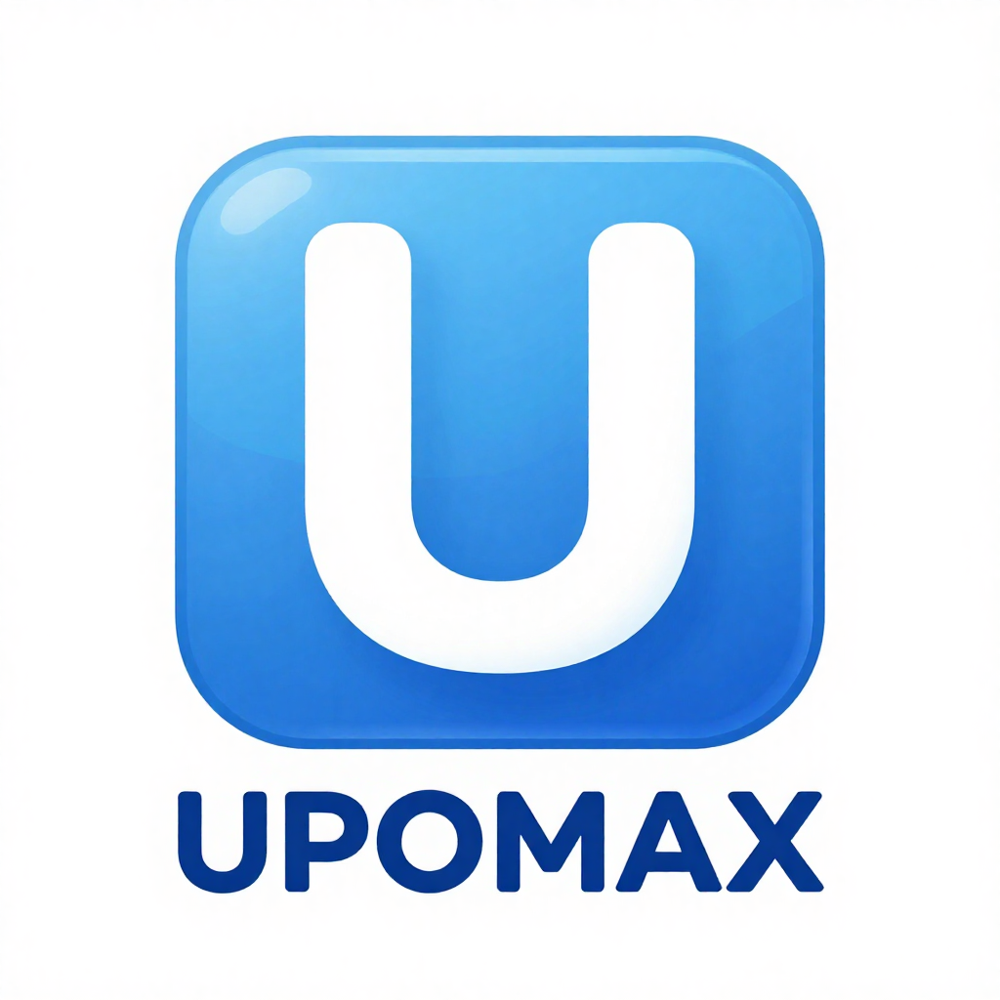
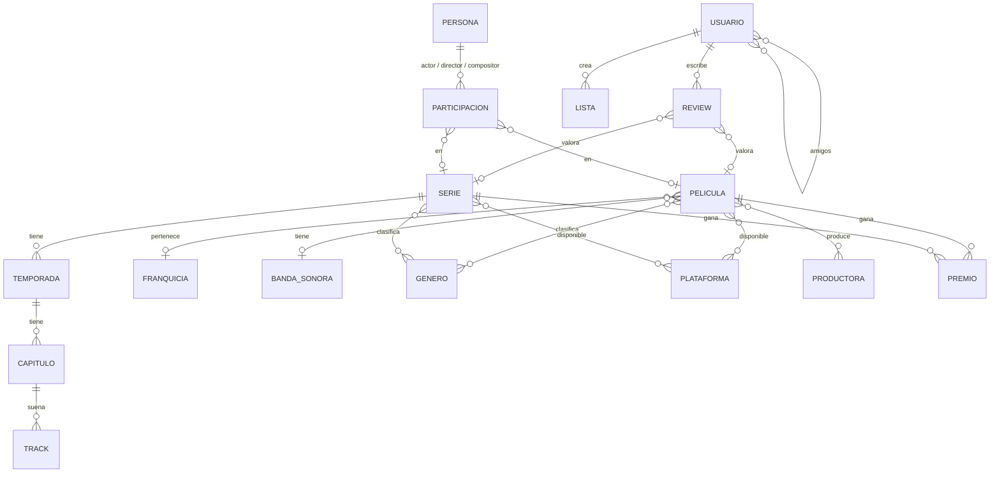

<div align="center">

UPOMAX
Plataforma para registrar, valorar y descubrir películas y series, construida como módulo de Odoo 19, con recomendaciones personalizadas mediante machine learning.


-F7DF1E?style=for-the-badge&logo=javascript&logoColor=black)

</div>
---
📸 Capturas
<!-- Sube tus capturas a docs/screenshots/ y descomenta estas líneas -->
<!--
| Menú principal | Ficha de serie | Recomendaciones IA |
|---|---|---|
|  |  |  |
> _Próximamente: capturas y GIF de la aplicación en funcionamiento._
---
✨ Funcionalidades
🎬 Catálogo completo de películas y series: temporadas, capítulos, géneros, plataformas, productoras, franquicias, bandas sonoras, premios y reparto (actores, directores, compositores).
⭐ Reseñas con nota del 1 al 10: la puntuación media de cada título se recalcula automáticamente con cada reseña.
🤖 Recomendaciones personalizadas con IA: un modelo de filtrado colaborativo sugiere a cada usuario el top 5 de títulos que aún no ha visto.
👥 Funciones sociales: perfiles, listas personalizadas de películas y series, y sistema de amigos.
🧩 Interfaces propias con OWL (el framework JS de Odoo) para gestionar películas, series, reseñas, géneros, premios, plataformas y tracks, con búsqueda e importación de películas y series desde CSV.
📄 Informes PDF de películas, series, premios, productoras y plataformas.
✅ Más de 40 validaciones de negocio: unicidad por título y año (para distinguir remakes y reboots), coherencia de fechas, temporadas y capítulos sin huérfanos, formato de email y contraseña, etc.
🔐 Roles de usuario y administrador con permisos por modelo.
---
🤖 Cómo funciona el motor de recomendaciones
El motor (`models/IA_recomendacion.py`) implementa factorización de matrices con descenso de gradiente conjugado, la misma idea que popularizó el Netflix Prize:
Construye una matriz usuarios × títulos a partir de las reseñas, mezclando películas y series en un único espacio.
Aprende 10 factores latentes por título y por usuario minimizando el error cuadrático con regularización L2 (`scipy.optimize.fmin_cg`).
Predice la nota que cada usuario daría a lo que no ha visto y guarda su top 5.
Se reentrena automáticamente cada día mediante una tarea programada de Odoo (`ir.cron`), o bajo demanda desde la ficha del usuario.
Gestiona el arranque en frío: si un usuario aún no tiene reseñas, se le invita a valorar contenido primero.
---
🗂️ Modelo de datos (simplificado)

---
🚀 Puesta en marcha
Requisitos: Docker y Docker Compose.
```bash
git clone https://github.com/Joseab010/UPOMAX.git
cd UPOMAX/odoo
docker compose up -d --build        # en Linux: docker compose -f docker-compose-linux.yml up -d --build
```
Abre http://localhost:18069 y crea una base de datos.
Ve a Aplicaciones, busca UPOMAX y pulsa Activar. Se cargan datos de ejemplo automáticamente.
(Opcional) pgAdmin está disponible en http://localhost:16543.
Para aplicar cambios en el código sin reiniciar el contenedor:
```bash
./upgrade_upomax.sh
```
---
🏗️ Estructura
```
odoo/
├── Dockerfile               # Odoo 19 + wkhtmltopdf + NumPy/SciPy
├── docker-compose.yml       # Odoo · PostgreSQL 18 · pgAdmin
└── addons/upomax/
    ├── models/              # 17 modelos ORM + motor de IA
    ├── views/               # Vistas XML, menús y búsquedas
    ├── static/src/components/  # Componentes OWL (JS + XML + SCSS)
    ├── reports/             # Informes PDF (QWeb)
    ├── security/            # Grupos y permisos de acceso
    ├── data/cron.xml        # Reentrenamiento diario de la IA
    └── demo/                # Datos de ejemplo en CSV
```
---
👥 Equipo
Proyecto desarrollado en equipo de 4 personas para la asignatura <!-- NOMBRE DE LA ASIGNATURA --> del Grado en Ingeniería Informática (Universidad Pablo de Olavide), entre septiembre y diciembre de 2025.
Mi aportación (@Joseab010):
Componentes OWL de gestión de plataformas, premios y reseñas.
Menú principal de la aplicación con Bootstrap.
Informe PDF de productoras.
Gran parte de las validaciones de negocio de series, temporadas, capítulos, tracks, películas, productoras y plataformas.
Filtros de búsqueda y vistas de premios, géneros y capítulos.
<!-- Añade aquí al resto del equipo con su usuario de GitHub si quieren aparecer -->

